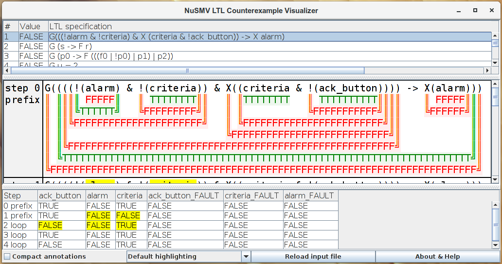
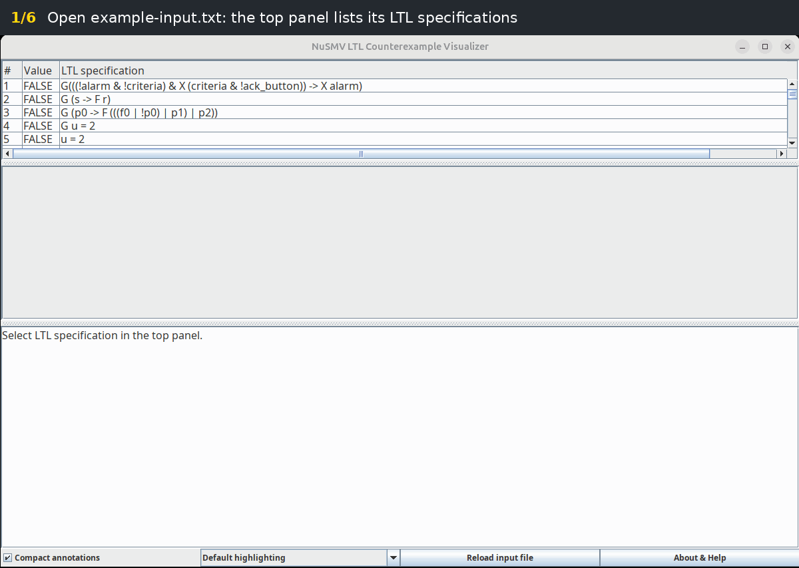
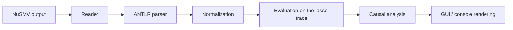

# NuSMV LTL counterexample visualizer

[](https://github.com/igor-buzhinsky/nusmv_counterexample_visualizer/actions/workflows/build.yml) [](LICENSE) [](https://github.com/igor-buzhinsky/nusmv_counterexample_visualizer/releases/latest)

**Explains *why* a temporal-logic property fails on a counterexample, using causal analysis.**

Model checkers such as [NuSMV](https://nusmv.fbk.eu/) and [nuXmv](https://nuxmv.fbk.eu/) verify a system model against requirements written in linear temporal logic (LTL), e.g. "every request is eventually followed by an acknowledgement". When a requirement fails, they print a counterexample: an execution trace that can run to dozens of steps and variables. Finding the few values that actually break the formula is left to the engineer.

This tool reads the model checker's output and shows:

* the truth value of **every subformula at every step** of the trace (middle panel below), and
* the **variable values that cause** the formula's outcome (highlighted in the bottom panel), computed with the causality algorithm of Beer et al. (CAV 2009).



It was developed for explaining counterexamples in the verification of function block diagrams, a common language of industrial automation software (see [Citation](#citation)). It also works as a teaching aid for LTL semantics on hand-written traces.

## Demo

Explaining why the first specification of [example-input.txt](example-input.txt) is FALSE: G fails on step 0 because the implication fails on step 1, and the implication fails because its premise holds while its conclusion `X(alarm)` does not.



## Quick start

1. Install [Java 8 or higher](https://adoptium.net/).
2. Download [visualizer-gui.jar](https://github.com/igor-buzhinsky/nusmv_counterexample_visualizer/releases/latest/download/visualizer-gui.jar) and [example-input.txt](example-input.txt).
3. Run:

   ```
   java -jar visualizer-gui.jar example-input.txt
   ```

4. Select a specification in the top panel. The bottom panel highlights the variable values that cause its outcome; click a subformula to also highlight the subformula values that determine it.

## Features

* Future-time (X, F, G, U, V) and past-time (Y, Z, O, H) LTL operators with NuSMV's operator precedence.
* Boolean, integer, real (nuXmv) and enumeration data; arithmetic (`+ - * / mod`), comparisons, `? :` and `count()`.
* Explanations of FALSE outcomes and, on hand-written traces, TRUE outcomes, which are explained via the negation of the formula. (NuSMV prints traces only for FALSE specifications.)
* A Swing GUI with two layouts (compact coloring of the formula, or T/F rows below each subformula) and two color schemes, and a console version with text output.
* An extended input format for writing traces by hand (see [below](#extended-input-format--educational-use-of-the-tool)).

## How it works



1. **Reading.** [`Reader`](src/main/java/nusmv_counterexample_visualizer/Reader.java) splits the model checker's output into specifications and traces. A counterexample to an LTL property is a *lasso*: a finite prefix followed by a loop that repeats forever. NuSMV only prints the variables that change, so the missing values are carried over from the previous step. If a trace has no loop (e.g., from bounded model checking), its last state is repeated forever.
2. **Parsing.** An [ANTLR grammar](src/main/antlr/ltl.g4) turns each formula into an abstract syntax tree of [LTL operators](src/main/java/nusmv_counterexample_visualizer/formula/ltl) over [arithmetic expressions](src/main/java/nusmv_counterexample_visualizer/formula/arithmetic). The parser is generated at build time.
3. **Normalization.** Implication, equivalence and xor are rewritten, F and G are expressed via U and V, and negations are pushed down to the propositions (negation normal form). The causality rules then need to cover only a few operators.
4. **Evaluation.** Each subformula is evaluated at each step, with results memoized. Future-time operators walk forward through the trace and wrap around the loop until a step repeats, which makes evaluation on the infinite trace finite. Past-time operators can see a different history on each pass through the loop, so the loop is first unwound by an amount estimated from the nesting of Y/Z and O/H.
5. **Causal analysis.** Following Beer, Ben-David, Chockler, Orni and Trefler, [*Explaining counterexamples using causality*](https://doi.org/10.1007/978-3-642-02658-4_11) (CAV 2009), a polynomial-time recursion over the normalized formula (with some enhancements) collects the (step, proposition) pairs that cause the outcome. They are then mapped to variable values.
6. **Rendering.** The causes of the outcome are highlighted in the formula's propositions and in the variable table. In the [GUI](src/main/java/nusmv_counterexample_visualizer/GUIMain.java), clicking a subformula value also highlights the values of its direct subformulas that determine it, so an explanation can be followed down the formula step by step. The [console](src/main/java/nusmv_counterexample_visualizer/ConsoleMain.java) version marks causes in text and can draw the annotated formula with box-drawing characters.

## Usage

### GUI

```
java -jar visualizer-gui.jar [input] [options]
```

Without an input file, the GUI opens a file dialog. If double-clicking the jar does not work on your system, run it from the console as above.

| Option | Description |
|---|---|
| `--mainFontSize <size>`, `--auxFontSize <size>` | Font sizes of the formula panel (default 20) and of the other panels (default 16) |
| `--highlightColor <color>`, `--trueColor <color>`, `--falseColor <color>` | Colors of the default highlighting mode, in the hex format (defaults `#ffff00`, `#008000`, `#ff0000`) |
| `--highlightChar <char>` | Character used to mark important Boolean values (default `*`) |
| `--monospacedFont <font>` | Font for the full (non-compact) annotations, e.g. `"Courier"`. Some fonts draw box-drawing characters with a different width, which breaks the layout |

### Console

[visualizer-console.jar](https://github.com/igor-buzhinsky/nusmv_counterexample_visualizer/releases/latest/download/visualizer-console.jar) writes the explanation to a text file:

```
java -jar visualizer-console.jar <in> <out> [--allVars] [--annotateFormulas]
```

For each step of each counterexample, the output lists the values of the variables in the formula, and values that cause the outcome are marked as `*var = value*`:

```
-- specification G(((!alarm & !criteria) & X (criteria & !ack_button)) -> X alarm) is FALSE
[prefix] step 0: values from the formula [ack_button =  TRUE] [alarm = FALSE] [criteria =  TRUE]
[prefix] step 1: values from the formula [ack_button =  TRUE] *alarm = FALSE* *criteria = FALSE*
[ loop ] step 2: values from the formula *ack_button = FALSE* *alarm = FALSE* *criteria =  TRUE*
[ loop ] step 3: values from the formula [ack_button =  TRUE] [alarm = FALSE] [criteria =  TRUE]
```

`--annotateFormulas` additionally draws the truth value of each subformula at each step, and is required to explain TRUE outcomes. `--allVars` also lists the variables that do not occur in the formula.

### GUI help

The top panel lists LTL specifications from the input file. Select one to see its trace in the middle panel. NuSMV prints traces only for FALSE specifications; with hand-written traces (see [Extended input format](#extended-input-format--educational-use-of-the-tool)), TRUE specifications can be visualized too.

In the middle panel, the values (T = true, F = false) of each subformula of the LTL specification are shown for each step of the counterexample. Click on a subformula value to see an explanation of it. As a result, this and some other values will be highlighted. In addition, important atomic propositions are highlighted in the LTL formula.

By default, subformula values are shown compactly, as colors of the formula itself. Uncheck "Compact annotations" (bottom left) to show them as T/F rows below each subformula, as in the screenshot. Explanations work in both layouts. The drop-down list next to it switches between the default and the MODCHK color schemes.

In the bottom panel, the values of all variables for all counterexample steps are provided. The values which are present in the LTL formula are shown on the left. Important values are highlighted.

## Notes on the input format

* The input file to the tool is the output file of NuSMV with LTL formulas and corresponding counterexample traces.
* Bounded operators (e.g., G[0, 3]) in LTL formulas are not supported. You will have to rewrite them manually (e.g., with X).
* Dashes (-) in identifiers are not supported, but $ and # are supported.
* Supported arithmetic: `+ - * / mod`, comparisons, Boolean connectives (`! & | xor xnor -> <->`), `? :` and `count()`. Other NuSMV operators (e.g., shifts, `case`, word and set operators) are not supported.
* Enumeration types with symbolic values are supported when a symbolic constant is a direct operand of = or != and the other operand is an enumeration variable (e.g., state = idle). Since the tool sees only the trace, not the type declarations, a misspelled constant (e.g., state = idel) cannot be detected and simply compares unequal.
* Supported past-time LTL operators: Y, Z, O, H. Unsupported past-time LTL operators: T, S.
* Since nuXmv counterexamples usually have the same format as NuSMV ones, the tool may be used on nuXmv counterexamples. Real (rational) data type is supported by the tool but timed traces and formulas are not.

## Extended input format & educational use of the tool

The tool supports the extension of the NuSMV output format, namely:

* Traces on which the LTL formula is TRUE are supported (the TRUE value of the formula will be explained). In this case, "is false" in the end can be replaced with "is true". Moreover, there is no need to write "is false" or "is true" at all, the value will be determined automatically.
* When NuSMV outputs LTL formulas, it puts redundant parentheses. In the input to the tool, they can be omitted. In this case, precedence of binary operators is U/V, &, |/xor/xnor, <->, -> (-> associates to the right). This complies with how NuSMV operates.
* LTL operator Release can be specified as V (NuSMV expresses this operator via Until).
* State numbers in traces can be omitted, i.e. "&nbsp;&nbsp;&nbsp;&nbsp;-> <-" would specify the start of the new trace element.
* No lines to start the trace (such as "-- as demonstrated by the following execution sequence") are required.

These extensions simplify the use of the tool when the input is produced manually (not by NuSMV). In particular, this can be useful to learn/teach LTL semantics.

## Development

### Project layout

| Path | Contents |
|---|---|
| [src/main/java/.../formula/ltl](src/main/java/nusmv_counterexample_visualizer/formula/ltl) | LTL syntax tree: evaluation, normalization, causal analysis |
| [src/main/java/.../formula/arithmetic](src/main/java/nusmv_counterexample_visualizer/formula/arithmetic) | Arithmetic and comparison expressions, exact rational numbers |
| [src/main/java/.../highlighting](src/main/java/nusmv_counterexample_visualizer/highlighting) | GUI highlighting modes |
| [src/main/antlr](src/main/antlr) | ANTLR grammar of LTL formulas |
| [src/test](src/test) | Tests, snapshot files and test inputs |
| [.github/workflows](.github/workflows) | CI and release workflows |

### Building

The build uses [Gradle](https://gradle.org/) through the included wrapper, so only JDK 17 or higher is needed (the built jars still run on Java 8):

```
./gradlew build
```

This generates the LTL parser from the ANTLR grammar, compiles the code, runs the tests, and builds self-contained jars (visualizer-console.jar and visualizer-gui.jar) in build/libs. On Windows, use `gradlew.bat` instead of `./gradlew`.

To publish a release, push an annotated tag such as `v1.2.3`: the [release workflow](.github/workflows/release.yml) builds and tests the project and attaches the jars and their SHA-256 checksums to a new GitHub release, using the tag message as release notes. Create the tag with `git tag -a v1.2.3 --cleanup=verbatim -F notes.md`: by default, git strips lines starting with `#`, i.e. Markdown headings, from tag messages.

### Testing

```
./gradlew test
```

The test suite (JUnit 5, in [src/test](src/test)) consists of:

* **Snapshot tests**: the console tool runs on the example inputs with different options, and the output is compared with the recorded files in [src/test/resources/golden](src/test/resources/golden). Any change in formula evaluation, causality analysis or rendering shows up as a diff. After an intended change, re-record them with `./gradlew updateGolden` and review the diff. Snapshots of removed inputs or options are not deleted automatically.
* **Model checker verdicts**: for every specification in the example inputs, the truth value computed by the tool must agree with the verdict printed by NuSMV/nuXmv.
* **Semantics tests**: the truth values of LTL formulas (future and past operators, precedence, arithmetic, reals, enumeration types) on small hand-written lasso traces.
* **Causality tests**: which variable values are reported as the causes of a formula's value.
* **Unit tests** for rational arithmetic.

CI runs the build on Linux and Windows and checks that the jars run on Java 8.

## Citation

If you use the tool in research, please cite the following paper (BibTeX and other formats are available via "Cite this repository" on the repository page):

* Pakonen A., Buzhinsky I., Vyatkin V. Counterexample visualization and explanation for function block diagrams. 16th IEEE International Conference on Industrial Informatics (INDIN). July 18–20, 2018, Porto, Portugal, pp. 747–753. IEEE, 2018 [[web]](https://ieeexplore.ieee.org/document/8472025) [[preprint]](https://cris.vtt.fi/ws/portalfiles/portal/19973783/OA_Counterexample_visualization_and_explanation.pdf)

## Bugs

If you see an error or something strange, you can open an issue here or email Igor Buzhinsky (igor.buzhinsky@gmail.com).
